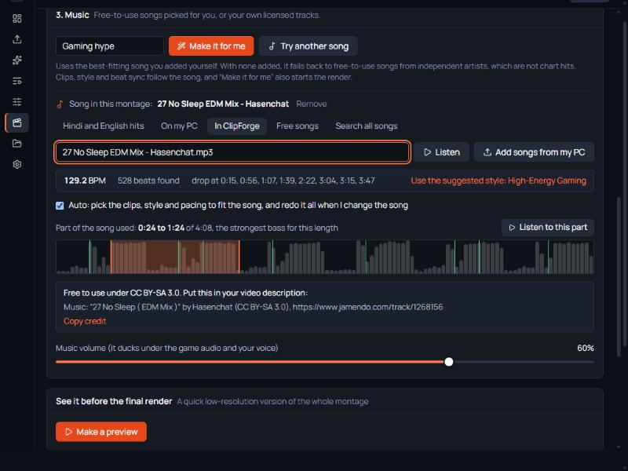

# ClipForge AI

Turn long gaming streams and recordings into polished clips and beat-synced montages, on your own Windows PC. Your videos stay on your PC, and there is nothing to pay for.

## Download

### [⬇ Download ClipForge AI for Windows (319 MB)](https://github.com/infernoxc/ClipForge-App/releases/latest/download/ClipForge-Setup-0.3.1.exe)

1. Download the file and double-click it.
2. Windows may say "Windows protected your PC", because the installer has no paid signing certificate. Click **More info**, then **Run anyway**.
3. Click through the installer. ClipForge opens by itself and adds a desktop shortcut.

You don't need to download again for new versions: go to **Settings**, then **Updates**, and press **Update now**. Your videos are kept.

You don't need to install anything else. To shut ClipForge down, open **Stop ClipForge** from the Start menu.

## What it does

* **Finds your best moments.** It reads the PUBG kill feed and on-screen messages, listens to the sound, and ranks the highlights. It works out your in-game name and tells your kills from your teammates' and other players'. For other games it relies on sound and on-screen change.
* **Cuts montages to the beat.** Cuts and kills land on the beat, from one video or several.
* **Picks the bass part of the song by itself.** Free songs are full length, from many genres and countries, and ClipForge chooses the strongest part for the length you pick. You can drag it to another part.
* **Ranks songs for your clips.** Hits are sorted by how well their beat fits the gunshots in the clips you selected.
* **Cuts each clip its own way.** Choose an Edit feel, or press Try another edit.
* **Keeps your sound real.** Your voice and gun sound keep their true speed and pitch through slow motion and speed ramps.
* **Gives you 42 editable styles,** plus 30 caption designs and 21 fonts. Save your own versions.
* **Frames your facecam.** It finds the facecam box for vertical, horizontal or square videos, and keeps your skin colour natural.
* **Opens and exports most file types.** Import any video, sound or picture, and export to 20 file types including MP4, MOV, MKV, WebM, GIF, MP3 and WAV.

## Music

Free songs are Creative Commons or public domain, and ClipForge downloads and credits them for you. You can also use your own songs. Chart hits play in full in YouTube's own player so you can preview your edit with them, but ClipForge never downloads them. Your video is cut to their beat, and you add the song in Instagram or YouTube Shorts when you post.

## What you need

* Windows 10 (version 1903 or newer) or Windows 11, 64-bit.
* About 1.3 GB for the app, plus room for your videos.
* Internet the first time you use speech features, because the speech models download then (up to 2 GB).
* A graphics card helps but is not required. ClipForge tests your AMD, NVIDIA or Intel card and uses it only if it works, otherwise your processor.

## Good to know

* So far it has been tested on one Windows 11 PC with an AMD graphics card, and with graphics-card encoding turned off. Other PCs are untested, so please [report any problem](https://github.com/infernoxc/ClipForge-App/issues).
* Your videos and clips are stored in `%LOCALAPPDATA%\ClipForge`. Uninstalling removes the app and keeps them.
* To uninstall, go to Windows Settings, then Apps, then ClipForge AI.
* Only use videos and music you have the right to use.
* ClipForge includes FFmpeg and other open-source software under their own licences. The list and links are in `THIRD-PARTY-NOTICES.txt` in the install folder, and FFmpeg's source code is at [ffmpeg.org](https://ffmpeg.org/download.html).
