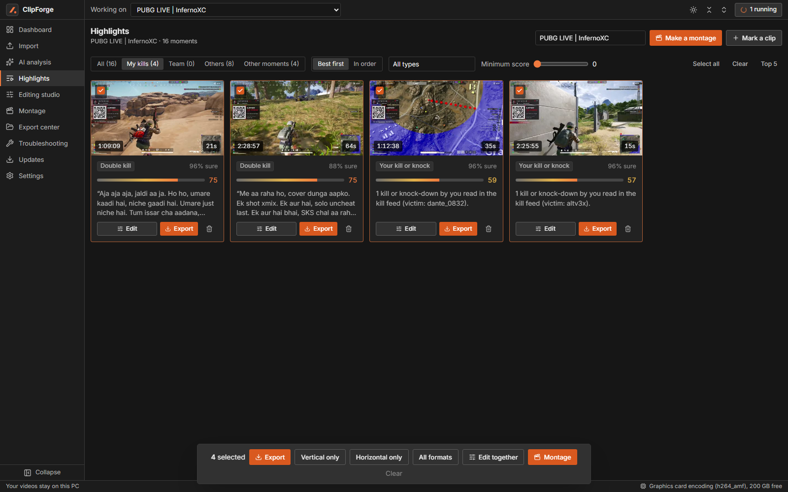
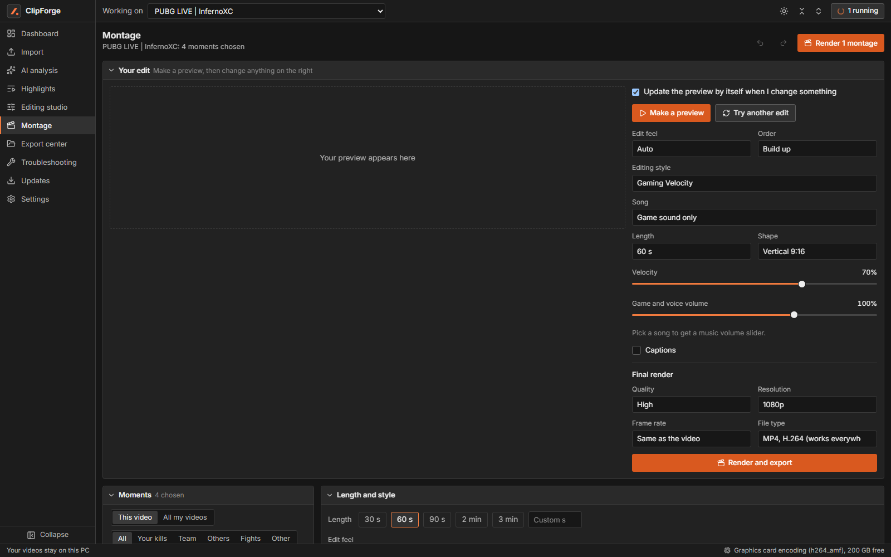
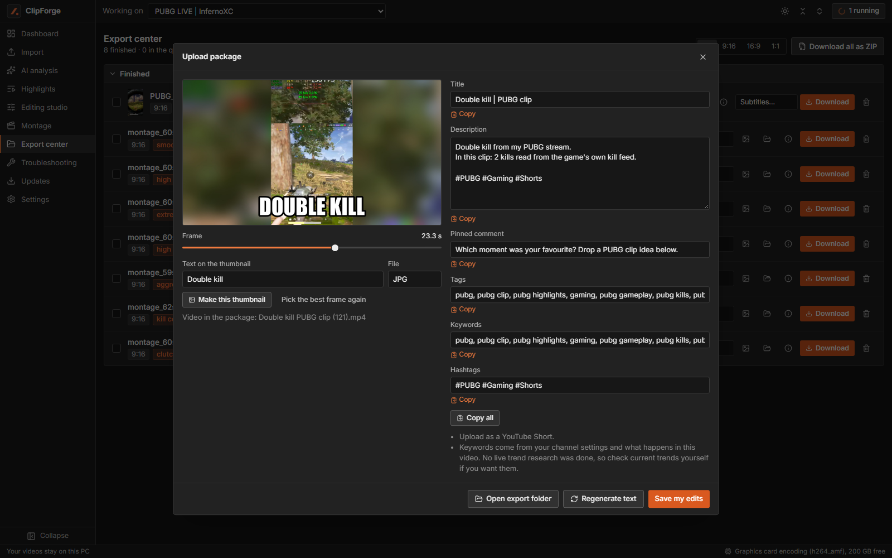
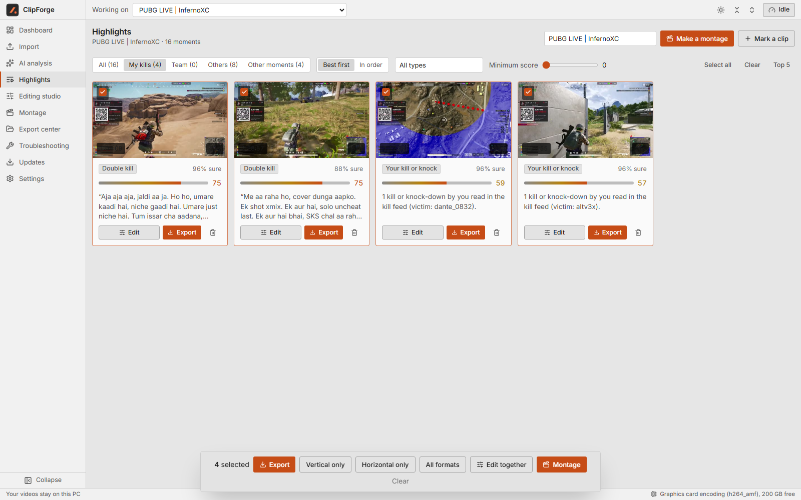
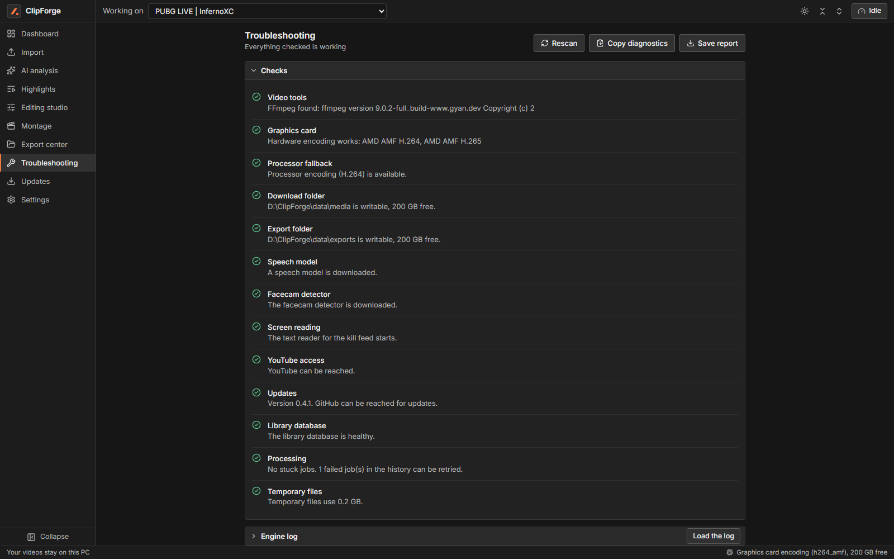

# ClipForge AI

**Turn hours of gaming streams into highlight clips, beat-synced montages and ready-to-upload YouTube packages, on your own Windows PC.** Free, local and private: your videos never leave your computer.

### [⬇ Download ClipForge AI for Windows (319 MB)](https://github.com/infernoxc/ClipForge-App/releases/latest/download/ClipForge-Setup-0.4.1.exe)

## What it does

**Finds the moments worth posting.** Point ClipForge at a long stream: a file on your PC, or a YouTube, Twitch or Kick video you have rights to. It reads the PUBG kill feed and the game's own "YOU KILLED" messages, listens for gunfire and your reactions, and works out your in-game name by itself. Each highlight covers the whole fight, from the first shots to the last, and it tells your kills from your teammates' and other players'.

**Lets you fix anything the AI got wrong.** Every highlight has an Edit window: drag the start and end, play the selection, save, or go back to the AI's choice.

**Cuts montages to the beat.** Pick your clips and a song, and every cut and kill lands on the beat. The preview re-renders as you change the style, order, edit feel, song or volumes. Free full-length songs come from many genres and countries, and ClipForge picks the strongest bass part for your length. Your voice and gun sounds keep their true speed and pitch through every slow-motion and speed ramp.

**Makes the upload package for you.** Every export comes with a folder holding the video, a thumbnail taken at one of your kills, and a YouTube_Metadata.txt with a title, description, tags and hashtags. You can edit and copy every field. The text only claims what is really in the video.

**And more**

* 42 editable styles, 30 caption designs and 21 fonts, with your own saved styles.
* A facecam box found automatically, with natural skin colour (colour grading touches the game picture only).
* Vertical, horizontal and square exports, 1080p to 4K, in 20 file types, including MP4, MOV, MKV, WebM, GIF, MP3 and WAV.
* Graphics-card encoding on AMD, NVIDIA and Intel when it works on your PC, with processor encoding otherwise.
* Dark and light mode, collapsible sections, and layouts that fit any window or monitor.
* A Troubleshooting page that checks everything ClipForge needs and repairs what it safely can.
* Updates from inside the app: open **Updates** in the left menu and press **Update now**.

## Install

1. [Download the installer](https://github.com/infernoxc/ClipForge-App/releases/latest/download/ClipForge-Setup-0.4.1.exe) and double-click it.
2. Windows may say "Windows protected your PC", because the installer has no paid signing certificate. Click **More info**, then **Run anyway**.
3. Click through the installer. ClipForge opens by itself and adds a desktop shortcut.
4. Import a video and press **Find highlights**.

Nothing else needs installing. ClipForge brings its own copies of Python and FFmpeg. To close it fully, open **Stop ClipForge** from the Start menu.

**Already installed?** Open **Updates** in the left menu and press **Update now**. Your videos, clips and settings are kept.

## What you need

* Windows 10 (version 1903 or newer) or Windows 11, 64-bit.
* About 1.3 GB for the app, plus room for your videos.
* Internet the first time you use speech features and captions, because the speech models download then (up to 2 GB). The speech model is chosen to fit your PC's memory. Analysis, editing and exporting then work offline.
* A graphics card is optional.

## Good to know

* **Games:** PUBG is fully supported. Valorant, Counter-Strike 2, Apex Legends, Fortnite and Call of Duty are experimental: highlights are found from sound and picture only, without kill-feed reading.
* **Music:** free songs are Creative Commons (CC BY, BY-SA or CC0) from Openverse, ccMixter and the Internet Archive, and ClipForge credits them for you. ClipForge never downloads chart hits. They play in YouTube's own player so you can preview your edit, and you add the song when you post.
* **Testing:** ClipForge has been tested on Windows 11 with an AMD graphics card, and with graphics-card encoding turned off. Other PCs are untested, so please [report any problem](https://github.com/infernoxc/ClipForge-App/issues).
* **Your files:** videos and clips are stored in `%LOCALAPPDATA%\ClipForge`. Uninstalling removes the app and keeps them.
* **Rights:** only use videos and music you have the right to use.
* **Licences:** ClipForge includes FFmpeg and other open-source software under their own licences. The list and links are in `THIRD-PARTY-NOTICES.txt` in the install folder, and FFmpeg's source code is at [ffmpeg.org](https://ffmpeg.org/download.html).
